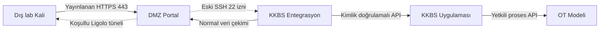

# KALKAN 1 Altyapı ve Teknik Gereksinimler

**Plan kimliği:** K1-INFRA-02  
**Tarih:** 31 Ekim 2026  
**Adres revizyonu:** R1 dış lab adres bloğu 198.18.60.0/24  
**Durum:** Kurulum için önerilen başlangıç mimarisi  
**Kapsam:** Tek fiziksel sunucu üzerinde Proxmox, Ansible, DMZ erişim zinciri, KKBS backend, saha ve PLC modeli, Wazuh ve çoklu ekran gösterimi

Tek fiziksel sunucuda 8 sanal makine ve 7 mantıksal ağ bölgesi önerilmektedir. Hedef, gerçek Linux oturumları ve ağ kayıtlarıyla desteklenen; saha ve PLC etkilerini sanal proses üzerinde gösteren bir tatbikat ortamıdır. Kırmızı takım dış lab ağından başlayacak, DMZ portalındaki servis zafiyetinden iç entegrasyon sunucusuna ilerleyecektir. KKBS uygulaması, entegrasyon sunucusu ve saha modeli ayrı VM'lerde çalışacaktır.

Bu belge bir kurulum planıdır. Yeni VM'ler, ağ kuralları, FastAPI geçişi, yeni saldırı scriptleri ve canlı Wazuh bağlantısı henüz uygulanmamıştır. IP adresleri ve kaynak tahsisleri öneridir; fiziksel sunucu envanteriyle eşleştirilmelidir.

## 1 Mevcut durum ve geliştirme kapsamı

| Bileşen | Mevcut durum | Yapılacak iş |
|---|---|---|
| Güncel frontend | DMZ anlatımı, rejiye özel altı teknik kart, 10 sunum adımı, PLC ve telemetri görünümleri hazırdır. | Güncel dosya ortak backend'e bağlanacak; yerel model ile canlı veri modu açıkça ayrılacaktır. |
| Backend v0.1 | Standart Python HTTP sunucusu, SQLite, rol denetimi, altı kontrollü etki komutu ve JSON günlükleri bulunmaktadır. | API, veri tabanı ve oturum katmanı geliştirilecek; entegrasyon ve proses rolleri ayrılacaktır. |
| Backend içindeki web kopyası | Önceki frontend sürümüdür. | Canlı entegrasyon, güncel frontend v3 üzerinde yapılacaktır. |
| Wazuh | Projeye ait uygulama kuralları ve bağlantı örnekleri bulunmaktadır. | Manager, indexer, dashboard ve ajanlar kurulacak; host ve ağ korelasyonları eklenecektir. |
| İlk erişim ve pivot | Servis zafiyeti, yerel yetki yükseltme, anahtar erişimi ve Ligolo akışı planlanmıştır. | Hedef servis ve zafiyet koşulları doğrulanacak; lab profili ve sıfırlama işlemleri hazırlanacaktır. |
| Proxmox ve Ansible | Seçilmiş altyapı yaklaşımıdır. Mevcut Ansible örneği tek backend hizmetini dağıtmaktadır. | VM oluşturma, ağ, temel işletim sistemi, Wazuh ve uygulama rolleri hazırlanacaktır. |

## 2 Kullanılacak teknolojiler

| Katman | Seçim | Kullanım |
|---|---|---|
| Sanallaştırma | Proxmox VE 9.2, x86-64 | QEMU/KVM VM'leri, ağ köprüleri, anlık görüntüler ve geri dönüş. Resmî indirmelerde 9.2-1 bulunmaktadır. [1] |
| Otomasyon | Ansible, community.proxmox, cloud-init, QEMU Guest Agent | Şablondan VM oluşturma, IP atama ve hizmet yapılandırma. API token, Ansible Vault ve TLS doğrulaması kullanılacaktır. [3] |
| Sunucu işletim sistemi | Ubuntu Server 24.04 LTS | FW, yönetim, DMZ, KKBS, OT ve Wazuh VM'lerinde ortak temel. Wazuh'un önerdiği sistemler arasındadır. [4] |
| Ağ geçidi | Ubuntu + nftables | Bölgeler arasında durum takipli, varsayılan olarak kapalı erişim politikası; izin ve engelleme kayıtları. |
| İç DNS ve zaman | dnsmasq ve chrony | FW-01'in ilgili bölge arayüzleri üzerinden lab DNS'i ve ortak zaman. |
| KKBS API | Python 3.12, FastAPI, Uvicorn, Pydantic | Kimlik doğrulama, rol denetimi, telemetri kabulü, komutlar ve olay kaydı. |
| Canlı yayın | REST ve WebSocket | Tek backend durumunun birden fazla bilgisayardaki monitörlere aktarılması. FastAPI WebSocket desteği sağlamaktadır. [6] |
| Veri tabanı | PostgreSQL 16, SQLAlchemy 2, Alembic | Varlıklar, onaylı kayıtlar, ölçümler, olaylar, oturumlar ve şema geçişleri. PostgreSQL 16 desteklenen bir sürümdür. [8] |
| Web ve TLS | Nginx, lab CA, HTTPS/WSS | Güncel frontend'in sunulması ve API ters vekili. WebSocket yükseltme başlıkları ve zaman aşımı ayarları yapılandırılacaktır. [7] |
| Hizmet yönetimi | systemd, Python sanal ortamları | Her sunucuda servis kullanıcısı, yeniden başlatma, çalışma sınırları ve günlük yönetimi. |
| Saha ve tesis modeli | Python tabanlı ayrı OT model hizmeti | 27 saha unsuru ve 4 tesis; fiziksel durum, bağımsız ölçüm ve yetkili proses komutları. |
| SIEM | Wazuh manager, indexer ve dashboard aynı VM'de | İlk kurulumda all-in-one yerleşim. Ajan, auditd, FIM ve JSON günlük toplaması. [4][5] |
| Kırmızı takım | Kali Linux ve Ligolo-ng | Dış lab istemcisi ve koşulları sağlanan pivot kanalı. Kali imajı ve araç sürümleri tatbikat öncesinde sabitlenecektir. [9] |
| Sürüm ve gizli bilgi yönetimi | Git, kilitlenmiş bağımlılıklar, Ansible Vault | Tekrarlanabilir kurulum; gerçek yönetim sırlarının hedef VM'lerden ayrılması. |

FastAPI ve ilgili Python paketlerinin uyumlu sürümleri bağımlılık kilidiyle kaydedilecektir. Wazuh merkezi bileşenleri aynı uyumlu sürüm kümesinden kurulacaktır. Ana sürüm seçimi güvenlik güncellemelerinin uygulanmasına engel olmayacaktır.

## 3 Fiziksel sunucu ve istemci gereksinimleri

| Kaynak | Başlangıç önerisi | Açıklama |
|---|---|---|
| İşlemci | En az 8 çekirdek ve 16 izlek sınıfı x86-64 | VT-x/AMD-V açık olmalıdır. Daha güçlü işlemci, log indeksleme ve eşzamanlı VM yüklerinde pay sağlayacaktır. |
| Bellek | 64 GB RAM | Aşağıdaki VM tahsisi toplam 26 GiB'dir. Host, dosya sistemi önbelleği ve yük artışı için ayrıca pay ayrılacaktır. |
| Disk | En az 1 TB SSD/NVMe kullanılabilir kapasite | VM diskleri toplam 360 GiB mantıksal tahsistir. İmaj, log, snapshot ve büyüme için ek alan gerekmektedir. |
| Disk dayanıklılığı | Tercihen iki SSD/NVMe ile ayna | Ayna yedek yerine geçmemektedir. ZFS seçilirse ek RAM rezervi ayrılacaktır. [2] |
| Ağ portu | Tercihen 2 fiziksel NIC | Yönetim ile gösterim erişimi ayrılacaktır. Tek NIC kullanılacaksa yönetilebilir switch ve VLAN trunk gerekecektir. |
| Ağ hızı | 1 GbE başlangıç için planlanmaktadır | Nihai sınır, ölçülen telemetri, log ve ekran trafiğiyle doğrulanacaktır. |
| Yedek | Ayrı disk, NAS veya başka bağımsız hedef | Aynı host üzerindeki snapshot, host arızasına karşı yedek değildir. |
| Görüntüleme | 4 izleyici, 1 Wazuh ve 1 özel reji ekranı | Bunlar 6 görüntü yüzeyidir; 6 ayrı bilgisayar gerekmemektedir. |
| Gösterim istemcisi | Güncel tarayıcılı Windows veya Linux | 1920×1080 ve 2560×1440 düzenleri gerçek monitörlerde doğrulanacaktır. Sunucu için ayrık GPU planlanmamaktadır. |

Bu değerler iş yüküne göre hazırlanmış başlangıç bütçesidir; ölçülmüş kapasite garantisi değildir. 32 GB RAM bulunan bir host için ayrıca daraltılmış pilot profil hazırlanmalıdır. Wazuh için 1–25 ajanlık resmî quickstart bütçesi 4 vCPU ve 8 GiB RAM'dir; bu planda 100 GiB disk ayrılmıştır. Saklama süresi gerçek log hacmine göre belirlenecektir. [4]

## 4 Ağ bölgeleri

| VLAN veya mantıksal bölge | Ağ | Ağ geçidi | İşlev |
|---|---|---|---|
| 10 MGMT | 10.77.10.0/24 | 10.77.10.1 | Proxmox ve Ansible yönetimi. |
| 20 DMZ | 10.77.20.0/24 | 10.77.20.1 | Dışarıya yayınlanan veri kabul portalı. |
| 30 KKBS | 10.77.30.0/24 | 10.77.30.1 | İç entegrasyon ve KKBS uygulaması. |
| 40 OT | 10.77.40.0/24 | 10.77.40.1 | Saha ve PLC model hizmeti. |
| 50 SOC | 10.77.50.0/24 | 10.77.50.1 | Wazuh ve mavi takım erişimi. |
| 60 DIŞ AĞ / İNTERNET LAB | 198.18.60.0/24 | 198.18.60.1 | İnterneti temsil eden kırmızı takım ağı ve pivot proxy'si. Dış kaynaklar 198.18.60.x ile ayrılacaktır. |
| 70 DISPLAY | 10.77.70.0/24 | 10.77.70.1 | Reji ve izleyici bilgisayarları. |

Bu adresler mevcut kurumsal ağlarla çakışma kontrolünden sonra kesinleştirilecektir. Dış lab için 198.18.0.0/15 ağ test bloğunun içindeki 198.18.60.0/24 alt ağı seçilmiştir. Bu adresler gerçek internete yönlendirilmeyecektir. [12] Kurulum paketleri için gereken gerçek internet erişimi hazırlık aşamasında ayrı, süreli bir bakım politikasıyla sağlanacaktır.

Dış yayın ve ağ geçidi adresi **198.18.60.1**, Kali ve Ligolo proxy adresi **198.18.60.20** olacaktır. İlk web erişiminin kaynak adresi 198.18.60.20 olarak izlenecektir. Pivot üzerinden açılan iç SSH oturumunda DMZ ajanının 10.77.20.20 adresinin görünmesi beklenmektedir.

Tamamen sanal kurulumda fiziksel portu olmayan ayrı Proxmox Linux bridge'leri kullanılabilir. Fiziksel switch'e taşınacak ağlarda VLAN aware bridge ve switch trunk yapılandırması gerekecektir. Kurulumda bu iki seçenekten biri açıkça seçilecektir; bütün VM'ler ortak bir köprüye bağlanmayacaktır.

Proxmox hostunun yönetim IP'si yalnız MGMT bölgesinde bulunacaktır. Hostun DMZ, RED ve OT köprülerine yönetim IP'si atanmayacaktır. FW-01 bölge başına arayüze sahip olacaktır. Diğer VM'ler tek bir bölgeye bağlanacaktır. Yönetim trafiği, ortak ikinci bir NIC yerine FW-01 üzerinden açıkça izin verilen yoldan geçecektir.

## 5 Sunucu envanteri

Proxmox fiziksel host adresi **10.77.10.10** olarak önerilmektedir. Bu host, aşağıdaki 8 VM'ye ek bir VM değildir.

| VMID | Sunucu | Ağ ve IP | İşletim sistemi | vCPU | RAM GiB | Disk GiB | Görev |
|---|---|---|---|---:|---:|---:|---|
| 100 | FW-01 | 7 bölgenin .1 adresleri | Ubuntu 24.04 | 2 | 2 | 20 | nftables, yönlendirme, dış portal yayını, DNS ve NTP. |
| 110 | MGMT-01 | MGMT 10.77.10.20 | Ubuntu 24.04 | 2 | 2 | 30 | Ansible, Git, kurulum envanteri ve lab CA yönetimi. |
| 120 | WAZUH-01 | SOC 10.77.50.20 | Ubuntu 24.04 | 4 | 8 | 100 | Manager, indexer ve dashboard. |
| 130 | KALI-RED-01 | DIŞ LAB 198.18.60.20 | Kali Linux | 2 | 4 | 60 | Kırmızı takım istemcisi ve Ligolo proxy. |
| 140 | DMZ-PORTAL-01 | DMZ 10.77.20.20 | Ubuntu 24.04 | 2 | 2 | 30 | Veri kabul portalı ve sürümü sabitlenmiş zafiyetli servis. |
| 150 | KKBS-INT-01 | KKBS 10.77.30.20 | Ubuntu 24.04 | 2 | 2 | 30 | DMZ verisini alan entegrasyon işçisi ve svc-sync SSH hedefi. |
| 160 | KKBS-APP-01 | KKBS 10.77.30.30 | Ubuntu 24.04 | 4 | 4 | 60 | Nginx, güncel frontend, FastAPI, WebSocket ve PostgreSQL. |
| 170 | OT-SIM-01 | OT 10.77.40.20 | Ubuntu 24.04 | 2 | 2 | 30 | Saha/PLC modeli, bağımsız referans ve proses API'si. |
| **Toplam** | **8 VM** | | | **20** | **26** | **360** | |

20 vCPU, VM'lere yapılan toplam tahsistir; 20 fiziksel çekirdek zorunluluğu anlamına gelmemektedir. Disk tahsisleri snapshot ve yedekler için ayrılan alanı içermemektedir.

Gösterim tarafında REJI-PC için **10.77.70.20**, izleyici istemcileri için **10.77.70.30–39**, mavi takım istemcisi için **10.77.50.30** önerilmektedir. Bir bilgisayarda birden fazla monitör kullanılırsa her monitöre ayrı IP gerekmemektedir.

İlk sürümde veritabanı KKBS-APP-01 üzerinde yerel çalışacaktır. PostgreSQL 5432 portu ağ bölgelerine yayınlanmayacaktır. Kapasite veya yetki ayrımı gerektirdiğinde ayrı veritabanı VM'si sonraki genişleme olacaktır.

## 6 İş akışı ve erişim zinciri

Normal iş akışında KKBS-INT-01, DMZ portalından HTTPS ile veri çekecektir. Entegrasyon işçisi doğrulanan veriyi KKBS-APP-01'e gönderecektir. KKBS uygulaması saha/PLC komutlarını yalnız yetkili uygulama kanalıyla OT-SIM-01'e iletecektir.

Kesikli bağlantılar tatbikatın zayıf yapılandırma profilini göstermektedir. DMZ'den KKBS uygulamasına veya OT ağına doğrudan yol açılmayacaktır. Böylece ele geçirilen servis anahtarının kullanılabilmesi için iç entegrasyon sunucusuna gerçekten geçilmesi gerekecektir.

| Teknik aşama | Yer | Gerekli koşul ve gözlem |
|---|---|---|
| İlk erişim | DMZ-PORTAL-01 | Yayınlanan serviste doğrulanmış RCE koşulu; servis kullanıcısı yetkisinde shell. |
| Dikey hareket | DMZ-PORTAL-01 | Lab profilindeki hatalı yerel sudo yetkisi; aynı VM'de yetki değişimi. |
| Kimlik erişimi | DMZ-PORTAL-01 | Eski aktarım işine ait kullanılabilir svc-sync özel anahtarının okunması. |
| Pivot | DMZ ve RED | Ligolo ajanı ile dış proxy arasında izinli TCP/TLS bağlantısı. Root, ajan için zorunlu önkoşul değildir. [9] |
| Yatay hareket | KKBS-INT-01 | Eski TCP/22 izni, kabul edilen anahtar ve etkileşimli SSH yetkisi. |
| Kalıcılık | Ele geçirilen lab hesabı | SSH anahtar değişikliği ve yeni oturumla doğrulama; kaynak ve hedef varlık açıkça kaydedilecektir. |
| Uygulama etkisi | KKBS-APP-01 | Entegrasyon hesabının uygulama kimliği ve gereğinden geniş yazma/komut yetkisi ayrıca doğrulanacaktır. |
| Saha etkisi | OT-SIM-01 ve izleyici ekranları | Konum, görev, HMI ve proses etkileri model verisiyle oluşacaktır. |

Bellekten kimlik bilgisi elde edilmesi ilk sürümün zorunlu adımı olmayacaktır. Anahtar dosyası erişimi, tekrar edilebilir bir kanıt noktası olarak kullanılacaktır. Ürün ve CVE henüz seçilmemiştir. Seçilecek servis, mevcut DMZ portalı anlatımına uymalı; düşük yetkili servis kullanıcısında çalışmalı ve zafiyet koşulları aynı imajla tekrar üretilebilmelidir. Önkoşulları doğrulanmamış bir CVE, uygulanmış teknik olarak raporlanmayacaktır.

## 7 Güvenlik duvarı erişim matrisi

Varsayılan politika gelen ve yönlendirilen trafik için **izin verilmeyen bağlantıların engellenmesi** olacaktır. Aşağıdaki kayıtlar yeni bağlantıları tanımlamaktadır; kurulmuş bağlantıların cevap trafiği durum takibiyle sağlanacaktır. Bölgeler arasında SNAT uygulanmayacak; böylece iç SSH oturumunda DMZ kaynak adresi korunacaktır.

| Kaynak | Hedef | Port ve protokol | Profil | Amaç |
|---|---|---|---|---|
| KALI-RED-01 (198.18.60.20) | FW-01 dış ağ adresi 198.18.60.1 | TCP 443 | Normal yayın | DNAT ile DMZ-PORTAL-01:443 uç noktasına erişim. |
| KKBS-INT-01 | DMZ-PORTAL-01 | TCP 443 | Normal | Veri paketlerinin iç ağdan çekilmesi. |
| KKBS-INT-01 | KKBS-APP-01 | TCP 443 HTTPS | Normal | Kimlik doğrulamalı entegrasyon API'si. |
| KKBS-APP-01 | OT-SIM-01 | TCP 443 HTTPS ve mTLS | Normal | Yetkili proses komutu ve referans sorgusu. |
| OT-SIM-01 | KKBS-APP-01 | TCP 443 HTTPS ve mTLS | Normal | Toplu telemetri gönderimi. |
| DISPLAY istemcileri | KKBS-APP-01 | TCP 443 HTTPS ve WSS | Normal | İzleyici, operatör ve reji oturumları. |
| Mavi takım istemcisi | WAZUH-01 | TCP 443 | Normal | Dashboard üzerinden analiz. |
| Mavi takım istemcisi | KKBS-APP-01 | TCP 443 | Normal | Mavi takım rolüyle uygulama müdahalesi. |
| REJI-PC 10.77.70.20 | WAZUH-01 | TCP 443 | İhtiyaca bağlı | Rejideki Wazuh bağlantısının kullanılabilmesi; Wazuh kimlik doğrulaması korunacaktır. |
| MGMT-01 | Proxmox 10.77.10.10 | TCP 8006 | Yönetim | Kısıtlı ve iptal edilebilir Proxmox API tokenı. |
| Yetkili yönetim istemcisi | Proxmox 10.77.10.10 | TCP 8006 | Yönetim | Proxmox yönetim arayüzü. |
| MGMT-01 | Hedef VM'lerin bölge IP'leri | TCP 22 | Yönetim | Ansible dağıtımı ve bakım. |
| Ajanlı VM'ler | WAZUH-01 | TCP 1514 | Normal izleme | Ajan olay aktarımı. [5] |
| Kayıt edilecek VM'ler | WAZUH-01 | TCP 1515 | Yalnız kurulum | Ajan kaydı; ilk kayıt sonrasında erişim daraltılacaktır. |
| İlgili bölge istemcileri | Kendi FW-01 ağ geçidi | UDP/TCP 53, UDP 123 | Altyapı | İç DNS ve ortak zaman. |
| DMZ-PORTAL-01 | KKBS-INT-01 | TCP 22 | **Yalnız zayıf lab profili** | Eski SFTP işinden kalan erişim istisnası. |
| DMZ-PORTAL-01 | KALI-RED-01 (198.18.60.20) | TCP 11601, TLS | **Yalnız zayıf lab profili** | Bu planda seçilen dış pivot uç noktası; aşırı geniş çıkış kuralını lab içinde temsil eder. |
| SOC yönetim kaynağı | WAZUH-01 | TCP 55000 | Gerektiğinde yönetim | Manager API; genel izleyici veya hedef VM erişimine açılmayacaktır. [5] |

11601 bu plan için seçilmiş lab portudur; HTTPS portu olarak tanımlanmamaktadır. HTTP proxy veya TLS denetimi bulunan bir çıkışta tünelin çalışacağı varsayılmayacaktır. Ligolo, ağ güvenlik politikasını ve SSH kimlik doğrulamasını kendiliğinden aşmamaktadır.

**Açılmayacak yollar:** RED'den doğrudan KKBS/OT/SOC/MGMT/DISPLAY erişimi; DMZ'den KKBS-APP veya OT'ye doğrudan erişim; entegrasyon sunucusundan OT'ye doğrudan komut; DMZ'den Proxmox yönetimi; ağ üzerinden PostgreSQL 5432 erişimi. DMZ'den SOC'a yalnız tanımlı Wazuh ajan akışları bulunacaktır. Wazuh indexer 9200 ve merkezi bileşenlerin kendi aralarındaki portları all-in-one VM içinde sınırlandırılacaktır. [5]

KKBS-INT-01 ve KKBS-APP-01 aynı alt ağda bulunduğundan aralarındaki kısıtlama FW-01 üzerinden sağlanamaz. Bu iki VM'nin host firewall kuralları, Proxmox VM firewall politikası ve API kimlik doğrulaması birlikte uygulanacaktır. Proxmox tarafındaki VM IP/MAC filtreleri, misafir işletim sistemindeki kaynak adresi değişikliklerine karşı yapılandırılacaktır. Aynı kural, aynı bölgedeki diğer uçlar için de geçerlidir.

## 8 Backend işlevsel gereksinimleri

### 8.1 Yetkili veri kaynağı ve canlı yayın

- OT-SIM-01 fiziksel proses modelinin ve bağımsız referansın kaynağı olacaktır. KKBS'de bildirilen verinin değiştirilmesi OT referansını otomatik değiştirmeyecektir.
- 27 saha unsuru ve 4 tesis toplam 31 veri kaynağı olarak tutulacaktır. Dört bölgenin varlık dağılımı korunacaktır.
- Başlangıçta 500 ms aralıkla toplu snapshot/yayın planlanmaktadır. Bu, monitör başına ayrı bir proses modeli çalıştırılması anlamına gelmemektedir.
- Kaynağın ölçüm zamanı ile backend'in paketi kabul ettiği zaman ayrı saklanacaktır. Veri tazeliği yalnız kaynağın bildirdiği zaman damgasına bağlı olmayacaktır.
- Tüm ekranlar aynı run_id, durum revizyonu ve sunucu zamanını kullanacaktır. Farklı bilgisayarlar tarayıcılar arası yerel depolama yerine backend üzerinden eşitlenecektir.
- Bağlantı kesildiğinde son değer ve veri yaşı gösterilecektir. Yeni veri alınmış gibi grafik veya paket zamanı üretilmeyecektir.
- Sunum adımı, saldırı işlemi ve telemetri zamanı ayrı kavramlar olacaktır. 30 saniyelik anlatım aralığı, gerçek tespit süresi olarak sunulmayacaktır.
- İlk sürüm tek durum yayımlayıcısıyla çalışacaktır. Birden fazla worker kullanılması gerekirse ortak olay dağıtımı ayrıca tasarlanacaktır.
- Durum değişikliği ve ilişkili denetim olayı aynı veri tabanı işlemi kapsamında kalıcılaştırılacak; istemcilere yayımlanan revizyon bu kayıtla eşleşecektir.

İlk kabul hedefi, yerel ağda alınan verinin yüzde 95'inin bir saniye içinde ekrana ulaşmasıdır. Sunucular arasındaki saat farkı bir saniyenin altında tutulacaktır. Wazuh alarm gecikmesi ayrıca ölçülecek; başlangıçta beş saniyelik yüzde 95 hedefiyle test edilecektir. Bunlar bu projeye ait test hedefleridir; ürün kapasitesi veya performans garantisi değildir.

### 8.2 API ve kullanıcı yetkileri

| Rol | İzin |
|---|---|
| viewer | Snapshot, telemetri ve izinli olayları okur; komut gönderemez. |
| operator | Yetkili tesis üzerinde sınırlandırılmış PLC komutu verir. |
| integrator | Normalde yalnız tanımlı veri kabul ve aktarım işlerini yürütür. Zayıf lab profilindeki fazla yetki açıkça kaydedilir. |
| blue | Oturum/kimlik iptali, uygulama seviyesinde containment, geri yükleme ve doğrulama işlemlerini yürütür. |
| white | Yeni tur ve tatbikat yönetimi işlemlerini yürütür. |

URL'deki audience parametresi bir yetkilendirme mekanizması olarak kullanılmayacaktır. İzleyici yazma işlemleri backend'de reddedilecektir. OS'deki svc-sync SSH hesabı ile API'deki integrator kimliği eşleştirilecek; SSH oturumu açılması otomatik olarak API yetkisi sayılmayacaktır.

Mevcut tools/red.py etki istemcisi geliştirme ve kontrollü model testleri için korunabilir. Bu istemcinin çalışması, DMZ zafiyetinin kullanıldığına veya gerçek SSH geçişi yapıldığına dair kanıt olarak kabul edilmeyecektir. Canlı tatbikat bu aşamaları gerçek host ve ağ kayıtlarıyla ilişkilendirecektir.

### 8.3 Olay ve veri sözleşmesi

Asgari kayıt alanları: timestamp_utc, run_id, event_seq, event_type, asset_id, source_host, actor, action ve outcome. İlgili olaylarda srcip, dstip, authentication_method, session_ref ve kaynak kayıt referansı eklenecektir. SSH anahtarının yalnız parmak izi kaydedilecektir. Parola, özel anahtar, bearer token ve oturum çerezi günlüklerde bulunmayacaktır.

Kimlik doğrulayan süreç ile saldırganın kullandığı hesap ayrı tanımlanacaktır. Örneğin reference-validator bir anomaliyi üreten kontrol bileşenidir; saldırgan hesabı olarak raporlanmayacaktır. Ağ bağlantısının TCP kaynağı, proxy üst bilgisi ve uygulama işlem hesabı birbirine karıştırılmayacaktır.

Nginx ters vekili yalnız güvenilen istemci/vekil bilgilerini iletecek; dışarıdan verilen kaynak IP başlığı gerçek ağ kaynağının yerine geçirilmeyecektir. Komutlarda yetki, değer aralığı, hedef varlık, istek kimliği ve kayıt sırası kontrol edilecektir. Oturumlar sunucudan iptal edilebilecektir. WebSocket açılışı da kimlik ve kaynak kontrolüne tabi olacaktır.

## 9 Wazuh ve mavi takım gereksinimleri

| Kaynak | Toplanacak veri | Analiz amacı |
|---|---|---|
| DMZ portalı | Web erişimi, hata ve uygulama günlükleri | İlk istek ile servis davranışını ilişkilendirmek. |
| Linux süreçleri | auditd süreç, execve ve kullanıcı kimliği kayıtları | Servis → shell ve yetki değişimi zincirini incelemek. |
| Servis anahtar dosyası | Hedefli dosya erişim denetimi | Anahtarı okuyan süreci ve kullanıcıyı belirlemek. FIM tek başına dosya okumasını göstermemektedir. |
| Kalıcılık noktası | authorized_keys değişikliği ve SSH logu | Anahtar ekleme ve yeniden erişimi ilişkilendirmek. |
| FW-01 | İzin/engelleme, NAT ve bağlantı kayıtları | Dış erişim, tünel ve eski SSH kuralını ilişkilendirmek. |
| KKBS-INT-01 | SSH, servis ve entegrasyon günlükleri | Kullanılan hesabı, anahtarı ve API işlem zincirini belirlemek. |
| KKBS-APP-01 | Yapılandırılmış API, oturum ve değişiklik günlükleri | Konum, görev, ölçüm ve komut değişikliklerini doğrulamak. |
| OT-SIM-01 | Bağımsız ölçüm, komut ve hizmet günlükleri | Komuta resmi ile gerçek model durumunu karşılaştırmak. |

Mevcut uygulama kuralları 110101–110106 korunacak; DMZ RCE, sudo, anahtar okuma, pivot ve SSH korelasyonu için yeni kurallar eklenecektir. Ajan kurulumu ve manager tarafında gerçek alarm oluşumu ayrı kabul adımı olacaktır. Her telemetri örneği Wazuh alarmı yapılmayacak; işlevsel örnek geçmişi PostgreSQL'de, denetim ve anomali kayıtları Wazuh akışında tutulacaktır.

Mavi takım Wazuh üzerinde kayıtları inceleyecek, göstergeleri bağlamıyla doğrulayacak ve gerekli kontrolü ilgili kimlik, ağ veya uygulama aracında uygulayacaktır. İlk sürüm analist onaylı müdahale akışıdır. Dashboard üzerinde görülen bir alarm referansının elle yazılması otomatik teknik doğrulama sayılmayacaktır. Wazuh manager API ile indexer arama API'si ayrı arayüzler olarak ele alınacaktır.

DMZ servisini izole etme, servis anahtarını iptal etme, dış tüneli kesme, eski SSH iznini kaldırma, uygulama oturumunu sonlandırma ve yazma yetkisini daraltma ayrı kontrol noktaları olacaktır. Sonuç, yeni log ve telemetriyle doğrulanacaktır. APT değerlendirmesi ancak yeterli ek kanıtla ve güven düzeyiyle raporlanacak; yöntem taklidi ihtimali korunacaktır.

## 10 Yapılandırma ve geri dönüş gereksinimleri

Ansible rolleri Proxmox VM oluşturma, temel işletim sistemi, ağ geçidi, DNS/zaman, Wazuh, ajanlar, DMZ portalı, entegrasyon, KKBS uygulaması, PostgreSQL, OT modeli ve lab profilleri olarak ayrılacaktır.

Üç profil bulunacaktır: normal işletim, zayıf tatbikat yapılandırması ve iyileştirilmiş yapılandırma. Zafiyetli servis, hatalı sudo izni, lab SSH anahtarı, eski SSH kuralı, dış tünel izni ve fazla API yetkisi ayrı değişkenlerle yönetilecektir. Profiller arasındaki fark kayıt altına alınacaktır.

Yönetim anahtarları, Proxmox API tokenı ve lab CA özel anahtarı hedef VM'lerde bulunmayacaktır. Tatbikatta ele geçirilecek svc-sync anahtarı ayrı ve yalnız lab kapsamına ait olacaktır. Scriptlere gerçek kurumsal kimlik bilgisi eklenmeyecektir. Gizli bilgi içeren otomasyon adımları kayıtlarında maskeleme uygulanacaktır.

Yeni tur, yeni run_id oluşturacak; model durumunu ve lab yapılandırmasını temiz başlangıca döndürecektir. Wazuh ve olay kanıtları varsayılan olarak silinmeyecektir. VM snapshot'ları alınırken uygulama/veritabanı tutarlılığı sağlanacaktır. Yedek alma ve geri yükleme ayrı doğrulanacaktır.

## 11 Kurulum sırası ve kabul ölçütleri

Başlangıçta Proxmox yönetim bağlantısı, FW-01 ve MGMT-01'in temel erişimi oluşturulacaktır. Sonraki VM'ler MGMT-01 üzerindeki Ansible üzerinden üretilecektir. Böylece otomasyon sunucusunun kendi kurulumuna bağımlı bir başlangıç döngüsü oluşturulmayacaktır.

| Sıra | İş | Tamamlanma ölçütü |
|---|---|---|
| 1 | Fiziksel host envanteri ve Proxmox | Donanım, depolama ve yönetim erişimi doğrulanmıştır. |
| 2 | Ağlar ve FW-01 | 7 bölge ayrılmış; izinli ve yasak yollar test edilmiştir. |
| 3 | Ansible ve VM şablonları | Aynı envanterle VM ve temel ayarlar tekrar üretilebilmektedir. |
| 4 | Wazuh ve ajanlar | DMZ, FW, KKBS ve OT kaynaklarından gerçek kayıt ve test alarmı alınmaktadır. |
| 5 | KKBS API ve PostgreSQL | Okuma/yazma rolleri, kalıcı durum, oturum iptali ve yeniden bağlanma çalışmaktadır. |
| 6 | Entegrasyon ve OT modeli | 31 kaynak, bağımsız referans ve proses komutları ayrı çalışmaktadır. |
| 7 | Güncel frontend'in canlı bağlantısı | Farklı istemciler aynı olayı ve revizyonu göstermekte; veri kaybı görünür olmaktadır. |
| 8 | Zafiyetli servis ve lab profili | İlk erişim, yetki değişimi, anahtar erişimi, pivot ve SSH geçişi kaynak kayıtlarla doğrulanmaktadır. |
| 9 | Mavi takım müdahalesi | Anahtar iptali, ağ kuralı ve API yetki değişiklikleri zinciri kesmektedir. |
| 10 | Tam prova ve sıfırlama | Çoklu ekran, Wazuh, ses, veri bütünlüğü, hizmet dönüşü ve yeni tur birlikte doğrulanmaktadır. |

Ek kabul koşulları: İzleyici rolünün yazma istekleri reddedilmeli; DMZ'den APP ve OT'ye doğrudan erişim başarısız olmalı; normal profil altında eski SSH geçişi ve dış tünel engellenmeli; servis anahtarı iptal edildiğinde tekrar SSH oturumu açılamamalı; yalnız sunum adımı ilerlediği için sahte Wazuh alarmı veya yeni telemetri oluşmamalıdır.

## 12 Kurulum öncesinde kesinleştirilecek bilgiler

1. Fiziksel sunucunun CPU modeli, çekirdek/izlek sayısı, RAM, disk adedi/kapasitesi ve NIC sayısı.
2. Mevcut switch'in VLAN desteği, yönetim bilgisayarının bağlantısı ve gösterim bilgisayarlarının sayısı.
3. İç ağlar için 10.77.0.0/16 ve izole dış lab için 198.18.60.0/24 adres alanlarının mevcut ağlarla çakışıp çakışmadığı.
4. Kullanılabilir depolama, haricî yedek hedefi ve istenen log saklama süresi.
5. Zafiyetli web servisinin ürün/sürüm/CVE seçimi veya özel lab zafiyetinin kesin kapsamı.
6. Kurulum sırasında paket/imaj indirme yöntemi ve tatbikat sırasında gerçek internet erişiminin kapalı tutulması planı.

Bu bilgiler gelmeden kapasite ve fiziksel NIC eşlemesi kesinleştirilmiş kabul edilmeyecektir. Mimari, ağ rolleri ve geliştirme kapsamı bu belgeyle başlangıç için tanımlanmıştır.

## Kaynaklar

Erişim tarihi 31 Ekim 2026. Kaynaklar ürün özellikleri ve uyumluluk için kullanılmıştır. IP adresleri, VM tahsisleri, profil istisnaları ve uygulama tasarımı projeye ait önerilerdir.

1. Proxmox indirmeleri: https://www.proxmox.com/en/downloads
2. Proxmox donanım gereksinimleri: https://proxmox.com/en/products/proxmox-virtual-environment/requirements
3. Ansible Proxmox koleksiyonu ve kimlik doğrulama: https://docs.ansible.com/projects/ansible/latest/collections/community/proxmox/proxmox_kvm_module.html ve https://docs.ansible.com/projects/ansible/latest/collections/community/proxmox/docsite/guides.html
4. Wazuh quickstart ve desteklenen işletim sistemleri: https://documentation.wazuh.com/current/quickstart.html
5. Wazuh mimarisi ve bileşen iletişimi: https://documentation.wazuh.com/current/getting-started/architecture.html
6. FastAPI WebSocket desteği: https://fastapi.tiangolo.com/advanced/websockets/
7. Nginx WebSocket ters vekili: https://nginx.org/en/docs/http/websocket.html
8. PostgreSQL destek politikası: https://www.postgresql.org/support/versioning/
9. Ligolo-ng resmî belgeleri: https://docs.ligolo.ng/
10. NIST SP 800-82 Rev 3 OT güvenliği: https://csrc.nist.gov/pubs/sp/800/82/r3/final
11. Proxmox yönetim kılavuzu ve VLAN ağları: https://pve.proxmox.com/pve-docs/pve-admin-guide.pdf

12. IANA özel amaçlı IPv4 adresleri ve 198.18.0.0/15 ağ test bloğu: https://www.iana.org/assignments/iana-ipv4-special-registry
